# **AlLoRa:** Advanced layer LoRa

Cite this repository: [](https://doi.org/10.5281/zenodo.7741245)

<p align="center">
    
</p>

AlLoRa is a toolbox for transferring content over LoRa: whole files, not just a few bytes of
sensor data. It grew out of [LoRaCTP](https://github.com/pmanzoni/loractp), and adds larger
packets for faster transfers, pieces you can swap to fit your hardware, and a mesh mode to reach
further.
It is written in Python and MicroPython, so the same code runs on an ESP32 board, a Raspberry Pi
or a laptop.

The protocol is built with distributed Edge-AI in mind: field nodes that do not only send their
data, but also receive what they need to keep working, like a new radio configuration, a command
or a model. So files now travel both ways, from the field to the Hub and back.

Details of the protocol can be found in these articles:

* [AlLoRa: Empowering environmental intelligence through an advanced LoRa-based IoT solution](https://www.sciencedirect.com/science/article/pii/S0140366424000641?via%3Dihub)

* [A modular and mesh-capable LoRa based Content Transfer Protocol for Environmental Sensing](https://ieeexplore.ieee.org/document/10060496)

* [AI*LoRa: Enabling Efficient Long-Range Communication with Machine Learning at the Edge](https://dl.acm.org/doi/10.1145/3641512.3690040)

## Quick start

Plug in two T3S3 boards and run, from the root of this repository:

```bash
python3 tools/provision.py doctor --install   # installs mpremote and esptool if they are missing
python3 tools/provision.py setup
```

The wizard finds the boards, asks which one is the Edge and which the Hub, and asks for a
posture: **open**, **secure**, or **control**, which is secure plus signed commands (see
[Security](#-security)). It loads both boards, sends one real 1000-byte file to prove the link,
and leaves both running. Its last lines say where to put a file on the Edge and where it lands on
the Hub.

Each board must already run MicroPython for the wizard to find it, so a new board needs one
flash by hand first (step 2 of [Your first transfer](examples/Readme.md#your-first-transfer)).
Put the AlLoRa firmware from the
[Releases page](https://github.com/SMARTLAGOON/SMLG_AlLoRa/releases) under `firmware/`, and the
wizard offers to flash it.

What the wizard set up is written to `allora-fleet/`, in the folder you ran it from: the record of
the deployment and, in the control posture, its signing key. Keep that folder, and keep it out of git.
[`tools/README.md`](tools/README.md) has the wizard in full. To load the boards by hand instead,
follow [Your first transfer](examples/Readme.md#your-first-transfer).

## Index

- [Quick start](#quick-start)
- [Folders](#folders)
  - [AlLoRa](#allora): Nodes, DataSources and DataSinks, Connectors, Control, core pieces
  - [Examples](#examples)
  - [Firmware](#firmware)
  - [Tests](#tests)
- [How does it work?](#how-does-it-work)
  - [The config file](#-the-config-file)
  - [Communication logic](#-communication-logic)
  - [Packet structure](#-packet-structure)
  - [Identity and addressing](#-identity-and-addressing)
  - [Security](#-security)
  - [RF configuration](#-rf-configuration-and-the-trial)
  - [Mesh mode](#-mesh-mode)
- [Coming from v2](#coming-from-v2)

-----

# Folders

Inside the repository, you will find the following folders:

```
AlLoRa/          the library
examples/        runnable examples, by node type and by board
firmware/        MicroPython firmware and build targets for the supported boards
tests/           the test suite (CPython)
```

## [AlLoRa](AlLoRa)

It contains all the code needed to set up a communication network between devices, from a
point-to-point link to a Hub with many Edges. To build a deployment, you pick a few pieces from
it: a **node** for each board, a **Connector** for each node to reach the radio, and the places
where your data comes **in** and goes **out**.

<p align="center">
  
</p>

<details>
<summary><b>What is inside:</b> Nodes, DataSources and DataSinks, Connectors, Control, and the core pieces.</summary>

The modules at the top level are the core pieces every node uses. A folder holds a family of
alternatives you pick from (`Nodes/`, `Connectors/`, `Links/`, `Adapters/`, `DataSources/`,
`DataSinks/`), except `Security/` and `Control/`, which you use as a whole. A file named in
lowercase holds functions and constants; a capitalised one is named after the class it provides.

### [Nodes](AlLoRa/Nodes)

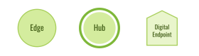

A node is the element in charge of the communication logic. There are two node types, named by
where they sit in the deployment, not by which way the data goes: the **Edge** in the field, and
the **Hub** that collects from it.

<br clear="right">

<details>
<summary><b>Edge</b>: the field node, with the sensors.</summary>

#### [Edge.py](AlLoRa/Nodes/Edge.py)

The Edge runs with the sensing application, serves its files to the Hub, and receives what the Hub
sends it (configurations, commands, models). It keeps one `Digital_Endpoint`, for its Hub, so a
file sent down has somewhere to land.

**Usage:**

1. **Instantiation:**

   - `connector`: the [Connector](#connectors-links-and-adapters) this node reaches LoRa through.
   - `config_file`: the node's [`AlLoRa.json`](#-the-config-file).
   - `datasource` (optional): where the files to send come from. Without one, you hand files over
     yourself with `set_file`.
   - `data_sink` (optional): where a file the Hub sends ends up.
   - `control_actuator` (optional): what carries out a verified command. See [Control](#control).

2. **Set a file:** `set_file(file)` takes an `AlLoRa_File` to serve. `get_chunk_size()` tells you
   the chunk size to cut it with.

3. **Run:** `run()` answers the Hub's requests forever. `run(timeout=60)` returns after a minute.

```python
edge = Edge(connector=connector, config_file="AlLoRa.json",
            datasource=Disk_DataSource(queue_path="Outbox"))
edge.run()
```

</details>

<details>
<summary><b>Hub</b>: the node that collects, one Edge or fifty.</summary>

#### [Hub.py](AlLoRa/Nodes/Hub.py)

The Hub coordinates the transfers. It visits each of its Edges in turn, pulls their files, and
hands them to its DataSink. It is also the one that sends files and commands down to an Edge. One
Edge or fifty, it is the same class.

**Usage:**

1. **Instantiation:**

   - `connector`, `config_file`: as for the Edge.
   - `nodes_file` (optional, default `"Nodes.json"`): the list of Edges to visit. See
     [The Edges it visits](#the-edges-it-visits-nodesjson) below.
   - `data_sink` (optional): where finished files go. The default saves them to disk.
   - `debug_hops` (optional, default `False`): record the path of each packet in mesh mode, on
     v2 links only. See [Mesh mode](#-mesh-mode).
   - `control_root` (optional): the signing key, for a Hub that sends signed commands. See
     [Control](#control).

2. **Run:** `run(save_files=True)` visits the Edges forever, the most overdue one first, and hands
   each finished file to the DataSink. Without `save_files=True` the files are received but not
   kept, which is only useful for tests.

3. **Send something down:**
   - `queue_downlink(endpoint, file)` sends a file to one Edge at the next safe moment.
   - `send_control(endpoint, control_type, payload)` sends a signed command (`RESET` or `CUSTOM`).
   - `ask_change_rf(endpoint, new_config)` moves one Edge, and the Hub with it, to new radio
     settings.

```python
hub = Hub(connector=connector, config_file="AlLoRa.json",
          data_sink=MQTT_DataSink(host="10.0.0.4", topic_prefix="albufera"))
hub.run(save_files=True)
```

#### The Edges it visits: `Nodes.json`

The Hub builds one [Digital Endpoint](AlLoRa/Digital_Endpoint.py) per active entry of `Nodes.json`. It
holds that Edge's name and address, its radio settings, how often to visit it, and the state of
the transfer in progress, and it assembles the `AlLoRa_File` once every chunk has arrived. You
rarely build one by hand. Each entry is one Edge:

```json
[
  {
    "name": "src",
    "mac_address": "9eeff0dc",
    "session_id": 42,
    "active": true,
    "wait_after_visit": 60,
    "listening_time": 30
  }
]
```

- `name`: a short nickname, used in logs and folder names.
- `mac_address`, `session_id` or `device_id`: how the Hub addresses this Edge. See
  [Identity and addressing](#-identity-and-addressing).
- `active` (default `true`): `false` keeps the Edge on the list without visiting it.
- `listening_time` (default 30 s): how long one visit lasts.
- `wait_after_visit` (default 60 s): how long this Edge rests before the next visit.
- `connector` (optional): this Edge's own radio settings, if they differ from the Hub's. Copy
  the `connector` block from the Edge's config; anything you leave out comes from the Hub's.
- `protocol_version` (optional): `2` for an Edge still running v2 firmware. The Hub speaks v2 to
  it for each visit, so one v3 Hub can serve a site part way through a reflash. Left out, the Edge
  is polled in the Hub's own version. Register a v2 Edge by `mac_address`; an entry registered by
  `device_id` cannot say `2`.

A Hub that cannot serve an entry's version stops at boot, naming the entry: a `secure` Hub, a
Hub whose radio has no MAC address (a serial or Wi-Fi bridge), or a v2 Hub given an entry that
says `3`. Sending a file down to a v2 Edge raises a `ValueError`, and so does asking it to change
radio settings from a v3 Hub.

The Hub retunes to each Edge's settings before visiting it, so one Hub can serve Edges on
different radio settings.

</details>

### [DataSources](AlLoRa/DataSources)


A DataSource feeds files to the node that sends them: a sensor reading becomes a file, an MQTT
message becomes a file. Hand one to a node, and the node sends whatever it queues.

<br clear="right">

<details>
<summary>The DataSources, and where their files come from.</summary>

<p align="center">
  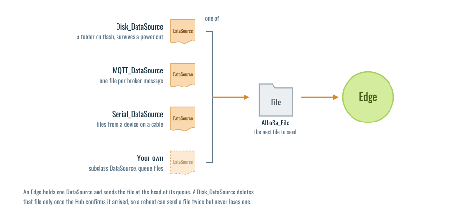
</p>

| DataSource | Files come from |
|---|---|
| [`DataSource`](AlLoRa/DataSources/DataSource.py) | your own code, through a queue in memory |
| [`Disk_DataSource`](AlLoRa/DataSources/Disk_DataSource.py) | a folder on flash, which survives a power cut |
| [`MQTT_DataSource`](AlLoRa/DataSources/MQTT_DataSource.py) | an MQTT broker, one file per message |
| [`Serial_DataSource`](AlLoRa/DataSources/Serial_DataSource.py) | another device on a serial cable |

`Disk_DataSource` deletes a file only once the other side confirms it arrived. After a reboot a
file may be sent twice, but it is never lost.

</details>

### [DataSinks](AlLoRa/DataSinks)

A DataSink takes each finished file, together with a `Reception`: who sent it and how it arrived
(RSSI, SNR, number of chunks, session). The default saves it to disk.

<details>
<summary>The DataSinks, and where their files go.</summary>

<p align="center">
  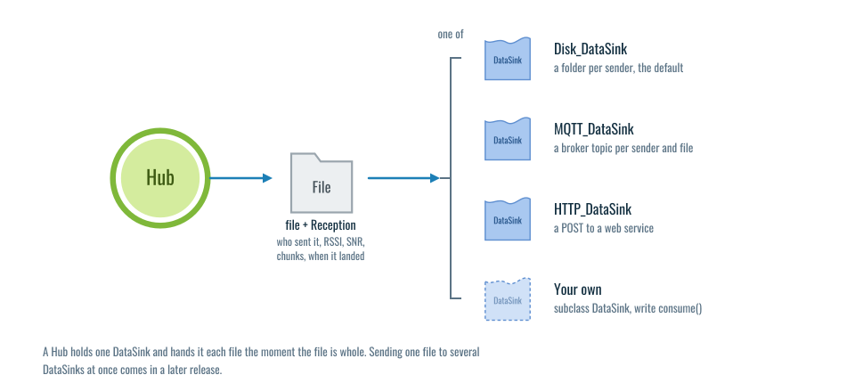
</p>

| DataSink | Each file goes to |
|---|---|
| [`Disk_DataSink`](AlLoRa/DataSinks/Disk_DataSink.py) | a folder named after the sender, under `Results/` (the default) |
| [`MQTT_DataSink`](AlLoRa/DataSinks/MQTT_DataSink.py) | an MQTT broker |
| [`HTTP_DataSink`](AlLoRa/DataSinks/HTTP_DataSink.py) | a web service, such as a control website |

To write your own, subclass `DataSink` and implement `consume(file, reception)`.

An `MQTT_DataSource` on one side and an `MQTT_DataSink` on the other make an MQTT bridge over
LoRa: the topic travels in the file name, and the message is republished on the same topic at the
far broker.

</details>

### Connectors, Links and Adapters

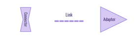

A **Connector** gives a node access to LoRa. Many boards have a LoRa radio, while others (like a
Raspberry Pi) do not, so the Connector is the bridge that makes AlLoRa available to as many kinds
of device as possible. When the radio sits on another board, the Connector is split in two, and a
**Link** joins the halves to an **Adapter** on the radio board.

<br clear="right">

<details>
<summary>The Connectors, the Links and the Adapters.</summary>

<p align="center">
  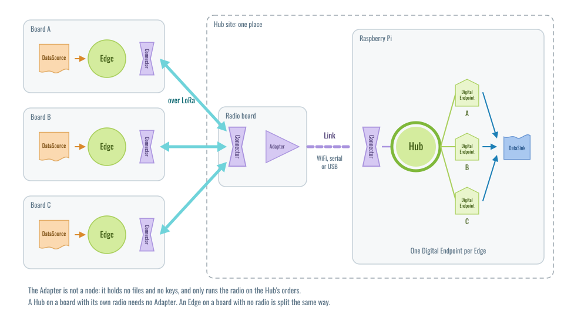
</p>

Three names sit at this layer, and they are not synonyms:

- **Connector**: a node's access to the LoRa channel.
- **Link**: the cable or network that joins the two halves of a split Connector.
- **Adapter**: the radio board at the far end of that Link.

Usually a node's Connector drives a radio on the same board, like the three Edges above. A
Raspberry Pi has no LoRa radio, so its Connector is **split in two halves**: the Hub holds the near
half, and a small radio board holds the far half inside an **Adapter**. The two halves talk over a
**Link** (WiFi, a serial cable, or USB). The Adapter is not a node: it holds no files and no keys,
and only runs the radio on the Hub's orders.

#### [Connectors](AlLoRa/Connectors)

Every Connector has the same methods (`transmit`, `listen`, `exchange`, plus the radio settings,
`mac` and `rssi`), so you can swap one for another without touching the node.

| Connector | For |
|---|---|
| [`SX127x_connector`](AlLoRa/Connectors/SX127x_connector.py) | ESP32 boards with an SX127x, and a Raspberry Pi with a Dragino LoRa HAT |
| [`SX1262_connector`](AlLoRa/Connectors/SX1262_connector.py) | Boards with an SX1262 (LilyGo T3S3) |
| [`LoPy4_connector`](AlLoRa/Connectors/LoPy4_connector.py) | Pycom LoPy4, using its native LoRa library |
| [`E5_connector`](AlLoRa/Connectors/E5_connector.py) | A Seeed E5 module driven over AT commands |
| [`Serial_connector`](AlLoRa/Connectors/Serial_connector.py) | The near half, over a serial cable or USB |
| [`WiFi_connector`](AlLoRa/Connectors/WiFi_connector.py) | The near half, over the network |
| [`Loopback_connector`](AlLoRa/Connectors/Loopback_connector.py) | Two nodes in one process, for tests |

#### [Links](AlLoRa/Links)

A Link only moves bytes. It knows nothing about packets or keys.

| Link | Media |
|---|---|
| [`Serial_link`](AlLoRa/Links/Serial_link.py) | UART and USB |
| [`WiFi_link`](AlLoRa/Links/WiFi_link.py) | HTTP over the network |
| [`Loopback_link`](AlLoRa/Links/Loopback_link.py) | tests on a computer |

`Serial_link` takes any port object that can write, read and say how many bytes are waiting, so
a direct USB cable already works with it.

#### [Adapters](AlLoRa/Adapters)

The program a radio board runs to serve the far half. The medium is in the class name, and the
radio is an argument:

```python
# node side                             # radio board side
connector = WiFi_connector()            adapter = WiFi_adapter(SX1262_connector())
connector = Serial_connector()          adapter = Serial_adapter(SX127x_connector())
```

</details>

### [Control](AlLoRa/Control)


A Hub can send an Edge a command: change your radio settings, restart, or something of your own.
Each command is signed with the deployment's **control root**, a signing key that stays with the
operator, and the Edge acts on it only once the signature checks out.

<details>
<summary>How a command travels, the command types, and how to add your own.</summary>

<p align="center">
  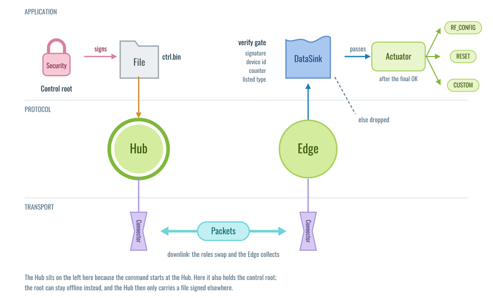
</p>

Every Edge holds the control root's public key from the day it is set up. On the Edge, two pieces
do the work:

- [`Control_Root_DataSink`](AlLoRa/DataSinks/Control_Root_DataSink.py) is the **verify gate**. It
  checks the signature and that the command is meant for this node, and passes on only what
  passes.
- [`Control_Actuator`](AlLoRa/Control/Control_Actuator.py) carries out a verified command. The
  default, `Node_Control_Actuator`, waits until the transfer has finished before it acts, so the
  Edge can still send its final acknowledgement.

<p align="center">
  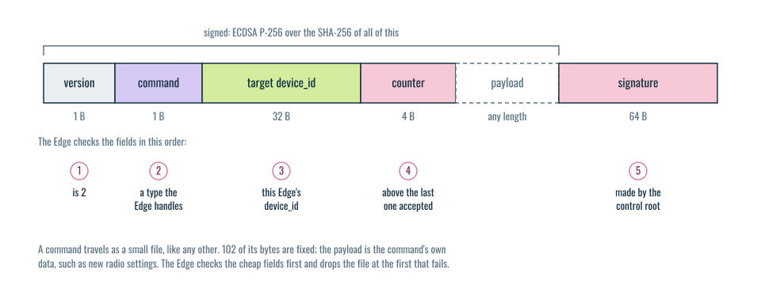
</p>

A command is a small file, and the Hub sends it like any other. Its first 38 bytes say which format
it uses, what kind of command it is, which Edge it is for, and its number. Then come the command's
own data and a 64-byte signature over everything before it. The Edge keeps the highest number it has
accepted, so a recorded command cannot be played back later.

| Type | Means |
|---|---|
| `RF_CONFIG` (1) | change the node's radio settings, with a [trial](#-rf-configuration-and-the-trial) |
| `RESET` (2) | restart the node: the board, or the AlLoRa program on a Pi |
| `MODEL` (3) | a new AiLoRa model for choosing the radio settings (no actuator yet) |
| `OTA` (4) | an update of AlLoRa itself (no actuator yet) |
| `CUSTOM` (5) | signed bytes for whatever runs beside AlLoRa, which AlLoRa never reads |

The [`control/`](examples/v3_hello/control) folder of the hello world shows how to set up the keys.

#### Add your own command

Subclass the actuator, list the types it handles, and queue the effect:

```python
class Camera_Actuator(Node_Control_Actuator):
    handles = Node_Control_Actuator.handles + (CUSTOM,)

    def apply(self, control_type, payload):
        if control_type != CUSTOM:
            return super().apply(control_type, payload)
        self.node.queue_control_action(lambda: camera_uart.write(bytes(payload)))
```

The Hub sends it with `hub.send_control(endpoint, CUSTOM, payload)`. An Edge only ever accepts
`CUSTOM` signed. [`examples/custom_command`](examples/custom_command) runs two such actuators on
your computer, one for a device on an ESP32's serial cable and one for a program beside AlLoRa on
a Pi.

</details>

### Core pieces


The modules at the top of `AlLoRa/`, which every node uses without you choosing them.

<details>
<summary>File, Packet, Codec and Pacing.</summary>

#### [File.py](AlLoRa/File.py)

`AlLoRa_File` is the unit being transferred. Created **with content**, it is cut into chunks and
served. Created **empty**, it is a container that receives the chunks and puts them back together.
A chunk that arrives twice costs nothing, and the order of arrival does not matter.

#### [Packet_v3.py](AlLoRa/Packet_v3.py) and [Packet.py](AlLoRa/Packet.py)

What a frame means: its kind, session, flags and payload. `Packet_v3` is the current format, and
`Packet` is the v2 one, kept so a v3 node can still talk to an old one. See
[Packet structure](#-packet-structure).

#### [Codec.py](AlLoRa/Codec.py)

Turns a Packet into bytes on the air and back. There is one per protocol version and security mode
(v2, v3 open, v3 secure).

#### [Pacing.py](AlLoRa/Pacing.py)

Sets the timing: how long to wait for a reply, and how long to pause between requests. It finds
the shortest pause the link can take by itself. To bound it, use
`node.pacing.set_sleep_bounds(min_sleep, max_sleep)`.

</details>

</details>

## [Examples](examples)

Examples of AlLoRa with different types of devices and levels of complexity. Learn by doing:

- [v3 hello world](examples/v3_hello): two T3S3 boards, one file over LoRa, open, secure or signed
- [A Hub on a Raspberry Pi or a computer, polling many Edges](examples/Hubs/Many-Edges)
- [Adapters](examples/Adapters), for a device with no radio of its own
- [Your own command](examples/custom_command), signed by the Hub and run beside AlLoRa

## [Firmware](firmware)

The MicroPython firmware and build targets for the supported boards. Start with
[Setting up AlLoRa in LilyGo T3S3 devices](firmware/T3S3/).

## [Tests](tests)

The test suite. It runs on a computer with CPython: `python3 -m pytest -q`.

-----

# How does it work?

<p align="center">
  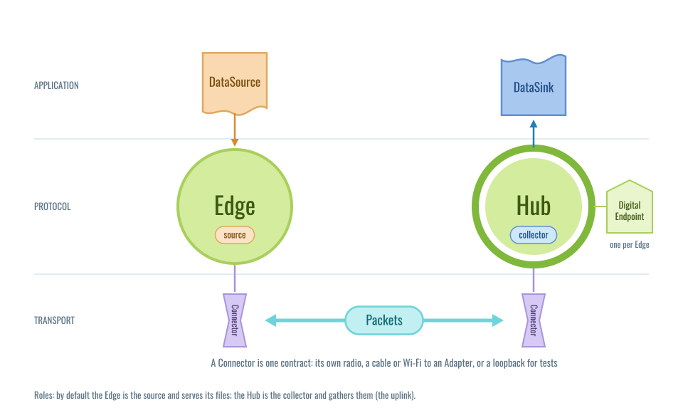
</p>

As we can see in the image above, the protocol is structured in a symmetrical way. At the left we
have the **Edge**, a field node that runs with the sensors and produces the files. A
**DataSource** feeds it those files, and a **Connector** gives it access to LoRa.

At the right we have the **Hub**, the node that coordinates the transfers with one or more Edges
and stores what they send. It keeps one **Digital Endpoint** per Edge, reaches LoRa through its own
Connector, and hands each finished file to a **DataSink**. Between them travel the **Packets**.

<p align="center">
  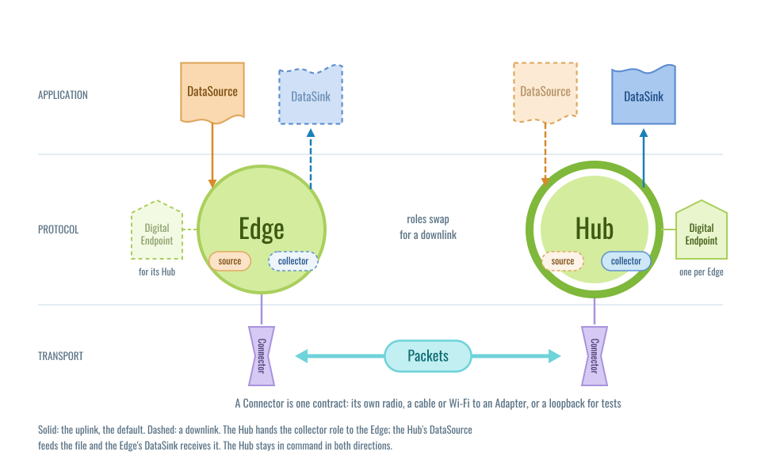
</p>

Files can also travel the other way, from the Hub to an Edge: a new configuration, a command, a
model. For this **downlink**, the Hub hands the driving to the Edge for one transfer, the Edge
pulls the file, and then everything goes back to normal. We call the two jobs in a transfer
**roles**: the **collector** drives and receives, the **source** holds the file and answers. By
default the Hub is the collector and the Edge is the source. The Hub stays in command in both
directions.

## → The config file

Every node, Edge or Hub, reads its settings from one JSON file, usually `AlLoRa.json`: which
packets it speaks, whether it is secure, and its radio settings. The sections below name the keys
they use.

<details>
<summary>An example, and what each key does.</summary>

```json
{
  "name": "S",
  "protocol_version": 3,
  "security_mode": "open",
  "session_id": 42,
  "mesh_mode": false,
  "connector": {
    "sf": 7,
    "freq": 868,
    "bandwidth": 125,
    "coding_rate": 1,
    "tx_power": 14
  }
}
```

- `protocol_version`: `3` for the v3 packets. Left out, the node speaks v2, so it can talk to an
  older deployment.
- `security_mode`: `"open"` (the default) or `"secure"`. See [Security](#-security).
- `chunk_size` (optional): leave it out and the node uses the largest chunk its packets can carry.
  If you set one that does not fit, the node lowers it at startup.
- `mesh_mode` (default `false`): see [Mesh mode](#-mesh-mode).
- `connector`: the radio settings, read by the Connector.

The [one program](examples/v3_hello/main.py) in `examples/v3_hello` also reads `node`, the radio
`driver`, and the `data_source` and `data_sink` blocks from this file, so an Edge and a Hub differ by
one line of JSON. Its [README](examples/v3_hello) lists them.

</details>

## → Communication logic

<p align="center">
  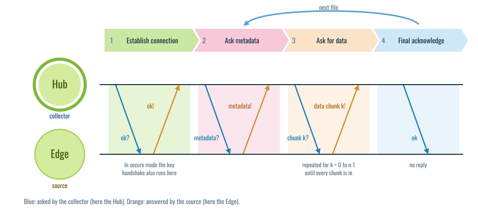
</p>

The system follows a logic of requests from the collector to the source. The collector sends a
request and waits for the reply. If nothing arrives, or it arrives corrupted, it asks again,
until the reply lands or a timeout runs out.

The Digital Endpoint moves through four states:

1. **Establish connection.** Every endpoint starts here. An OK goes out, and the endpoint waits for
   an OK back. In secure mode the key handshake also runs here.

2. **Ask metadata.** Ask what is coming: the file name, its size, and the chunk size the source
   used. The endpoint creates an empty `AlLoRa_File` to hold the chunks.

3. **Ask for data.** Ask for the chunks one by one until the file is complete. Then it is put back
   together and handed to the DataSink.

4. **Final acknowledge.** A closing OK keeps both nodes in step. The source waits for it before it
   counts the file as delivered and moves on to the next one.

<p align="center">
  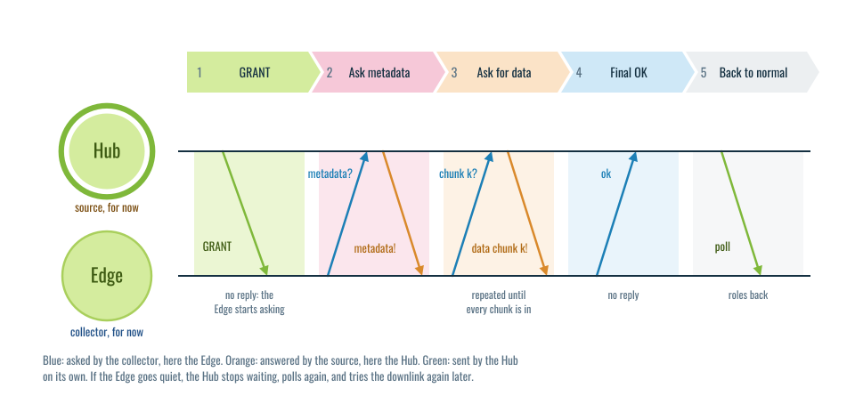
</p>

A downlink swaps the roles. Between two files, the Hub sends the Edge a **GRANT** in place of the
first step, and from then on the Edge asks and the Hub answers. Once the Edge's final OK lands, the
Hub polls again and everything is back to normal. If the Edge goes quiet halfway, the Hub stops
waiting, polls anyway, and tries the downlink again later.

## → Packet structure

The format lives in [`Packet_v3.py`](AlLoRa/Packet_v3.py) (v2 in [`Packet.py`](AlLoRa/Packet.py)).

The Packet is the fundamental unit sent over LoRa. A LoRa frame carries at most 255 bytes (at SF7
to SF10; less at SF11 and SF12), so every byte of header is a byte of data lost. It seems like a
small difference, but when sending kilobytes of data, every byte counts.

<p align="center">
  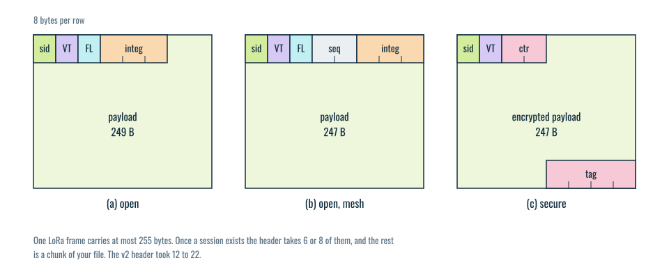
</p>

Once a session exists, a v3 header starts with a 1-byte **session id** (`sid`) instead of two MAC
addresses. Then come:

- **VT** (1 byte): the protocol version (`3`) and the kind of message.
- **FL** (1 byte): the flags, one per bit.
- **integ** (3 bytes): the first 3 bytes of `sha256(payload)`, to catch a corrupted frame.
- **seq** (2 bytes, mesh only): a sequence number, so a forwarded packet is not forwarded twice.

The VT and FL bytes, bit by bit:

<p align="center">
  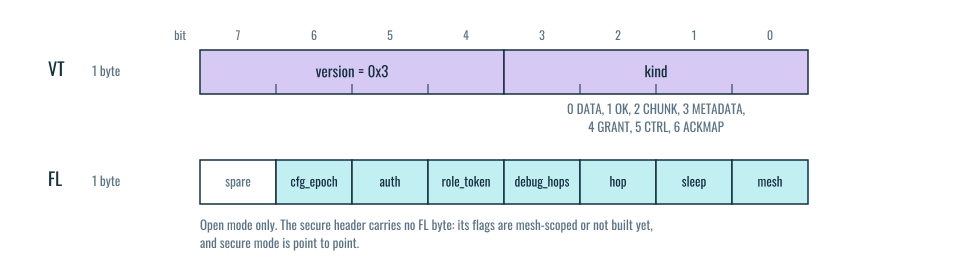
</p>

In secure mode the flags and `integ` give way to a 2-byte counter (`ctr`), which stops a recorded
frame from being replayed, and a 4-byte authentication tag (`tag`) after the encrypted payload.
So an encrypted v3 chunk still carries less header than an unencrypted v2 one:

| Framing | Header | Payload at SF7 |
|---|---|---|
| v2, point to point, compressed MACs | 12 B | 243 B |
| v2, point to point, full MACs | 20 B | 235 B |
| v2, mesh, compressed MACs | 14 B | 241 B |
| **v3 open** | **6 B** | **249 B** |
| v3 open, mesh | 8 B | 247 B |
| **v3 secure** | **8 B** | **247 B** |

<details>
<summary>The v2 packet, still spoken to v2 nodes.</summary>

- **MAC addresses (16 bytes):** 8 bytes of source MAC, then 8 of destination.
- **Command and flags (1 byte):** the command type plus several flags.
- **Checksum (3 bytes):** the last 3 bytes of a SHA-256 digest, as hex.
- **Message ID (2 bytes, mesh only):** a random number between 0 and 65,535, to drop duplicate
  retransmissions.

Optional MAC compression packs each address from 8 bytes to 4, which gives the 12-byte and
14-byte rows in the table above.

<div align="center">
<table>
<tr>
<th>Point-to-Point Packet</th>
<th>Mesh Packet</th>
</tr>
<tr>
<td>
<pre>

</pre>
</td>
<td>
<pre>

</pre>
</td>
</tr>
</table>
</div>

The v2 flag byte:

<p align="center">
  
</p>

1. **Command (2 bits):** `00` DATA (the payload is a requested chunk), `01` OK (connection
   acknowledged, or content received), `10` CHUNK (a request for one chunk, whose number is in the
   payload), `11` METADATA (file name and size, asked for or given).
2. **Mesh bit:** the message should be forwarded.
3. **Hop bit:** the message was forwarded at least once.
4. **Debug hop bit:** replace the content with the path, for research.
5. **Change RF bit:** a change of radio settings between nodes.

</details>

## → Identity and addressing

A node has three names: its **MAC**, its **device_id** (from its key), and a 1-byte **session
id**. The first frame to a node uses the first or the second, and once a session exists every
frame uses the third.

<details>
<summary>The three names, and the header each one uses.</summary>

<p align="center">
  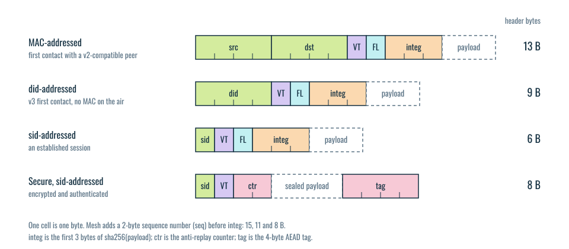
</p>

- **MAC:** the board's physical address. In v3 it is a label, a folder name, and, for an Edge
  registered by MAC, the address of the secure handshake (the 13-byte header). In `open` its low
  byte becomes the session id.
- **device_id:** an Edge's v3 identity, the fingerprint of its public key (`SHA256(pubkey)`). It
  stays the same across reboots as long as `identity_file` is set. In `secure` the Hub does not
  yet check that an Edge holds the key behind it (see [Security](#-security)). A first
  contact by `device_id` uses the 9-byte header, with no MAC on the air.
- **session id:** the 1-byte address of one Edge and Hub session, used once the session exists (the
  6-byte header). It comes from the node's identity by default, and you can set it with
  `session_id` in the config.

How the first frame is addressed follows how the Edge was registered in `Nodes.json`: by MAC or by
`device_id`. Either way a v3 Hub speaks v3, unless the entry says `"protocol_version": 2` (see
[The Edges it visits](#the-edges-it-visits-nodesjson) above).

</details>

## → Security

AlLoRa has two modes, picked with `security_mode` in the config: **open** (the default, no
encryption) and **secure** (every frame encrypted and authenticated). The wizard and the examples
offer three postures: **open**, **secure**, and **control**, which is secure plus signed
commands (see Commands below).

<details>
<summary>How the secure mode works, how to set it up, and what it does not protect.</summary>

- **`open`** (the default): no encryption. The integrity check catches corrupted frames, not an
  attacker.
- **`secure`**: the two nodes agree on a session key with an **ECDH handshake on P-256**. Then
  every frame is encrypted with **AES-128-CTR**, authenticated with a **4-byte HMAC-SHA256 tag**,
  and numbered. A frame whose tag does not match is dropped unread, and so is a replayed one.

<p align="center">
  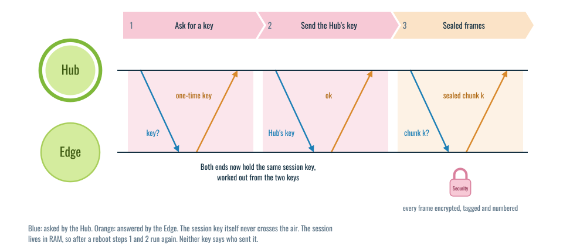
</p>

**The handshake.** The first time a Hub visits an Edge, it asks for a key. The Edge answers with a
one-time public key, the Hub answers with a key of its own, made fresh each time the Hub starts,
and both work out the same session key from the two. The handshake runs once per session, never
per frame. The curve math is pure Python, so it runs on any board. The per-frame AES on a board
needs the AlLoRa firmware, which uses the ESP32's hardware AES; on a computer it comes from the
`cryptography` package. A node set to `secure` with no AES available stops at startup with an error, rather than
running unprotected without telling you. For tests only, `allow_insecure_fallback` lets it run
`open` instead.

**Setting it up.** Set `"security_mode": "secure"` on both nodes, and give the Edge an
`identity_file`:

```json
  "security_mode": "secure",
  "identity_file": "identity.key",
```

On its first boot the Edge creates its key in that file. Its `device_id` is `node.device_id`, and
the example program prints it at every boot. Register that `device_id` in the Hub's `Nodes.json`, in place of the MAC (see
[Identity and addressing](#-identity-and-addressing)). Keep the key file: a full reflash that
erases it gives the Edge a new key and a new `device_id`, and the Hub keeps polling the old one
and hears nothing, with no error on either side. Without `identity_file`, the Edge makes a new key
at every boot, which is only useful for tests.
[`examples/v3_hello/secure`](examples/v3_hello/secure) walks through it on two boards.

**After a reboot.** Sessions live in RAM, so a rebooted Edge has none. The Hub notices once the
Edge has been silent for `session_recovery_after` visits (3 by default): it polls again, and if
that goes unanswered too, it drops the session and handshakes from scratch on the next visit. A
few visits of data are lost; nothing has to be done by hand.

**Commands.** With a [control root](#control) provisioned, the Hub signs every command and the
Edge refuses any that is unsigned. Create it once, on your laptop, with
[`provision_control_root.py`](examples/v3_hello/control/provision_control_root.py): it writes the
signing half for the Hub and the checking half for the Edges. Both nodes then name it with
`"control_root_file": "control_root.key"`. Signed commands need `secure` on both nodes, because a
command names its Edge by `device_id`. Without a control root, the only command a Hub can send is
a change of radio settings, unsigned, and any nearby radio can send one too. The [`control/`](examples/v3_hello/control) folder has the steps.
Set up by hand that way, the Hub holds the key and signs. The [wizard](tools/README.md) keeps
the key on your computer, in `allora-fleet/`, and the Hub passes the signed commands along.

**What `secure` does not protect.** It is built for environmental monitoring, where the data is
not secret but a forged command would be serious. Someone with a LoRa radio within range can:

- read the data an Edge sends, because the handshake does not check who is on the other end;
- pose as a registered Edge and send the Hub false data, knowing only its `device_id`;
- drain an Edge's battery by polling it;
- make an Edge believe one transfer was delivered when the Hub never got it;
- pull an Edge onto a session of their own, until the Hub's recovery brings it back.

They cannot send a command the Edge will act on, if a control root is provisioned. A third mode,
`strict`, where the Edge also checks the Hub's identity, is designed but not built: a node set to
it stops at startup.

`secure` protects the LoRa link between Edge and Hub. What happens after the Hub, on the way to a
cloud or a database, is up to the deployment.

</details>

## → RF configuration and the trial

The Hub can move an Edge to new radio settings. The Edge tries them first, and keeps them only
once a full chunk has crossed; if not, it goes back to the settings it had.

<details>
<summary>Why, and how the Hub follows the Edge.</summary>

<p align="center">
  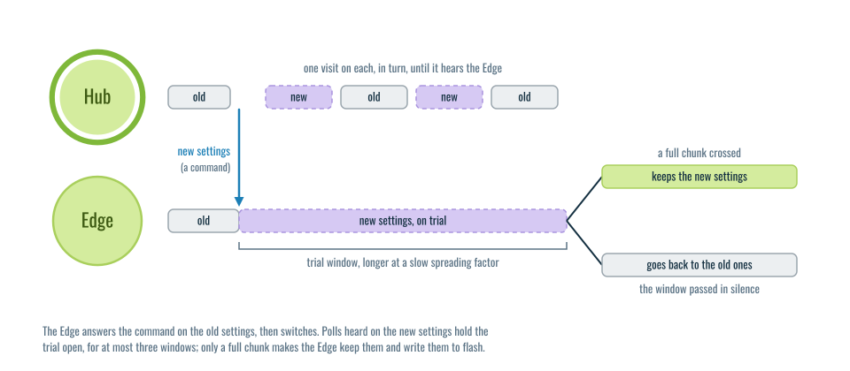
</p>

New radio settings (spreading factor, bandwidth, frequency, coding rate, TX power) have to be sent
over the very link they might break. So the Edge does not keep them on arrival: it switches, tries
them for a while, and keeps them only once a full chunk has crossed. If the trial window passes in
silence, it goes back to the settings it had before, which are known to work.

While the trial runs, the Hub listens on both the old and the new settings, one per visit, so it
finds the Edge whichever way the trial went. The window is in seconds, and its default grows with
the time on air, since a frame at SF12 takes about thirty times longer than at SF7.

</details>

## → Mesh mode

> Mesh mode was used in the field with v2. It has not been tested on v3 yet.

If the mesh mode is activated, the communication works exactly as described above, except that
when a request goes unanswered a set number of times, the Digital Endpoint enters
**retransmission mode**: it sets the mesh bit, asking the other nodes in range to forward the
message and extend the reach of the system.

<details>
<summary>How the forwarding works, and the debug hops tool.</summary>

A node that receives a packet that is not for itself normally drops it. With the mesh bit set, it
forwards it instead, after sleeping a random 0.1 to 1 second, to reduce collisions when several
nodes are active and in range of each other. Each forward sets the hop bit, so we can see the
packet went through other nodes. When the destination sees that a message came in retransmission
mode, it replies with the mesh bit set too, since the reply will probably need the same path back,
and it does *not* sleep first: the node being asked always has priority.

If a reply arrives with the hop bit off, it came straight from the Edge, so the Hub turns
retransmission mode off for that Edge.

To avoid duplicates flooding the system, each new packet gets an id, which every node keeps in a
fixed-size list and checks whenever a mesh packet arrives. A second list holds the ids already
forwarded, so nothing is forwarded twice.

**Secure mode is point to point only.** The library refuses `secure` together with `mesh_mode`.

### Debug hops

> Debug hops works on v2 links only (`protocol_version` 2). A v3 packet has no room to record
> the path yet.

Debug hops is an option on the Hub (`debug_hops=True`), useful to check the path of a packet in mesh
mode. It replaces the content of the message and uses the payload to record each node the packet
goes through. The Hub saves this, and you can use it to decide where to place the nodes in the
area to cover.

The output is a `log_rssi.txt` that looks like this:

```
2022-06-17_17:11:40: ID=24768 -> [['B', -112, 0.5], ['A', -107, 0], ['B', -106, 0.3], ['C', -88, 0.2], ['G', -100, 0]]
2022-06-17_17:11:50: ID=2065 -> [['C', -99, 0.4], ['B', -93, 0], ['C', -93, 0.2], ['G', -105, 0]]
2022-06-17_17:11:53: ID=63728 -> [['C', -100, 0.4], ['B', -95, 0], ['C', -95, 0.5], ['G', -103, 0]]
2022-06-17_17:11:54: ID=32508 -> [['B', -114, 0], ['C', -95, 0.4], ['G', -103, 0]]
2022-06-17_17:11:56: ID=10063 -> [['C', -99, 0.1], ['B', -95, 0], ['C', -94, 0.1], ['G', -103, 0]]
```

Each line shows the time of reception, the id of the message, and the list of hops. Each hop
records the node's name, the RSSI of the last packet it received, and the random time it waited
before forwarding. In some hops the wait is 0. This is not chance: those nodes were the
destination of the request, and as we said before, they have priority.

</details>

-----

# Coming from v2

<details>
<summary>The v2 names, and what they are called now.</summary>

| v2 name | v3 name | Note |
|---|---|---|
| `Source` node | **`Edge`** | |
| `Requester` | **`Hub`** with one Edge | |
| `Gateway` | **`Hub`** with many Edges | same class |
| `Gateway.check_digital_endpoints()` | **`Hub.run()`** | |
| `CTP_File` | **`AlLoRa_File`** | |
| `Interface` | **`Adapter`** | transport, not a node |
| `DataSource` | `DataSource` | now under `AlLoRa.DataSources` |

A year-old `main.py` needs two edits: `Source` becomes `Edge`, and both `Requester` and `Gateway`
become `Hub`. Pass the constructor arguments **by keyword**, since the order changed, and drop
`NEXT_ACTION_TIME_SLEEP`: the v3 nodes refuse it (the timing adapts by itself now, see
[Pacing](#core-pieces)). To run old code unchanged, use the `v2.0.0` tag.

</details>
